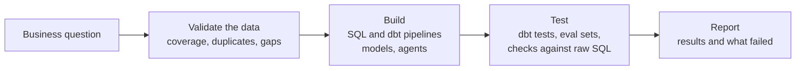

<h1 align="center">Hi, I'm Siddhartha</h1>
<h3 align="center">I build analytics and AI tools, then test whether the results actually hold up.</h3>

  
  
  

Data analyst and data scientist · Master of Data Science, RMIT University (2026).

- 🟢 **Open to** data analyst, data scientist and AI engineering roles in Australia
- 🔭 Building **[The Substitution Gap](https://github.com/siddharthaananthula/substitution-gap)** in public: ranking grocery substitutes by whether shoppers accept them, not by product similarity (in progress)
- 💬 Ask me about **dbt testing, MCP agents and how to evaluate them, or why I chose not to publish an uplift number**
- 📄 Published: *CAPTCHA Recognition Using DCNN*, IJSREM, 2023
- 🏆 Best Demonstration Award, RMIT Open Day 2026

### How I work

### Findings from my projects

| Finding | Project |
|---|---|
| **80.28%** of revenue came from mixed-brand baskets, which were 57.0% of all baskets | [Retail Performance Analytics](https://github.com/siddharthaananthula/retail-performance-analytics) |
| **78.28%** of transaction lines had no matching promotion record, so I rejected the observational design before estimating any uplift | [Promo Effectiveness](https://github.com/siddharthaananthula/promo-effectiveness) |
| **9 of 10** out-of-scope and adversarial requests correctly escalated or refused by an MCP-connected agent | [Internal Help-Centre Agent](https://github.com/siddharthaananthula/internal-help-centre-agent) |
| **69%** of populated Victorian SA2 areas had no mapped AFL community venue | [Grassroots Footy Map](https://github.com/siddharthaananthula/afl-accessibility-map) |

### Tools

### Featured projects

| Project | What it shows |
|---|---|
| [**Retail Performance Analytics**](https://github.com/siddharthaananthula/retail-performance-analytics) | 2.6M transaction lines through PostgreSQL and dbt (20 models, 73 tests, CI) into a seven-page Power BI report, with key figures checked against independent SQL. [Site](https://siddharthaananthula.github.io/retail-performance-analytics/) |
| [**Promo Effectiveness**](https://github.com/siddharthaananthula/promo-effectiveness) | Tests whether campaign data can support an uplift estimate, finds it can't, and designs a randomised holdout sized with a power analysis instead |
| [**Internal Help-Centre Agent**](https://github.com/siddharthaananthula/internal-help-centre-agent) | OpenAI tool-calling agent with read-only MCP tools, a 30-question evaluation set, cost and latency logging, and a go-live agent card (prototype) |
| [**300,000 Streets of Melbourne**](https://github.com/siddharthaananthula/300-000-School-Streets) | Team capstone with Regen Melbourne: school-street safety screen built from crash, OpenStreetMap, EPA and ABS data, with a Leaflet.js dashboard. [Dashboard](https://siddharthaananthula.github.io/300-000-School-Streets/) |
| [**Grassroots Footy Map**](https://github.com/siddharthaananthula/afl-accessibility-map) | 252 AFL community venues mapped against ABS disadvantage data across Victoria. [Map](https://siddharthaananthula.github.io/afl-accessibility-map/) |
| [**The Substitution Gap**](https://github.com/siddharthaananthula/substitution-gap) | Grocery substitution ranking based on shopper behaviour, with customer-level evaluation (in progress) |
